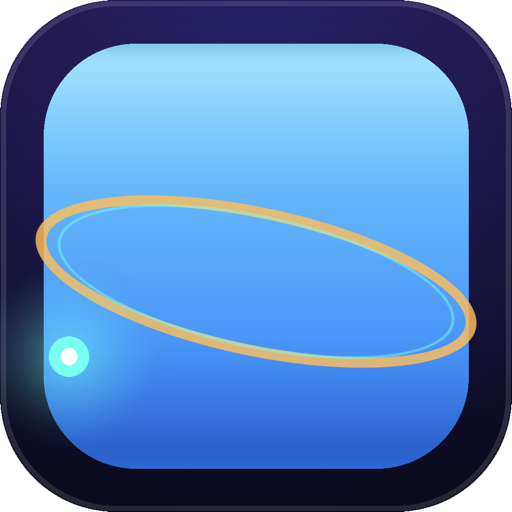

<div align="center">
  

  <h1>celist.db</h1>

  <p><strong>The database app for the rest of us.</strong><br>
  Design tables, edit rows, and run SQL — all in one friendly window.<br>
  No SQL required for 90% of the work. A full SQL blade for the other 10%.</p>

  <p>
    <a href="#-macos-edition"></a>
    <a href="#-windows-edition"></a>
    
    
    
    
    <a href="LICENSE"></a>
    <a href="CONTRIBUTING.md"></a>
  </p>

  <p>
    <a href="#download--install">Download</a> ·
    <a href="#features">Features</a> ·
    <a href="docs/ARCHITECTURE.md">Architecture</a> ·
    <a href="ROADMAP.md">Roadmap</a> ·
    <a href="CONTRIBUTING.md">Contributing</a>
  </p>
</div>

---

## What is celist.db?

celist.db is a local-first SQLite database manager that feels like a desktop
productivity app instead of a developer tool. It takes the *easiest* parts of
Microsoft Access (visual table design, an editable datasheet), MySQL Workbench
(an object browser, a real SQL editor), and phpMyAdmin (import/export,
relationships, backups) and puts them behind one ribbon-driven window.

You can go from an empty folder to a working, queryable database without typing
a single line of SQL — and drop into raw SQL the moment you want to. Everything
is stored in a single portable `.db` file you own, in the format every tool
understands.

> **Design principle:** the UI speaks *tables, columns, and rows*. SQL is
> generated for you, shown to you, and always overridable.

## Editions at a glance

| | 🍎 **macOS edition** | 🪟 **Windows edition** |
|---|---|---|
| Runtime | Native **SwiftUI** app | **Electron** desktop app |
| Engine | **GRDB** over system SQLite | **sql.js** (SQLite → WebAssembly) |
| Storage | Direct file access | Direct file access |
| Min. OS | macOS 14 (Sonoma) | Windows 10 / 11 (64-bit) |
| Source | [`macos/`](macos) | [`windows/`](windows) |

Both editions share the same product model and file format, so a database
created on one opens on the other.

## Features

### 🗂 Design tables without SQL
- **Visual table designer** — add and remove columns, pick types from a curated
  list, set `PRIMARY KEY`, `NOT NULL`, `UNIQUE`, `AUTOINCREMENT`, `DEFAULT`, and
  foreign-key targets.
- **Live SQL preview** — a read-only pane shows the exact `CREATE TABLE`
  statement that will run, before you commit it.
- **Type auto-suggest** — name a column `email` and get `TEXT`; name it `qty`
  and get `INTEGER`. You can always override.
- **Sample database** — one click loads a ready-made shop schema (customers,
  orders, products) with rows, so you can explore before committing to design.

### 📊 Edit data like a spreadsheet
- **Inline cell editing** committed straight to the database, with type-aware
  parsing (numbers parse, blanks become `NULL`).
- **Sort by clicking headers**, **filter with a search box**, and page through
  large tables without leaving the grid.
- **Add, duplicate, and delete records** from the ribbon.

### ⌨️ Use SQL when you want to
- **SQL editor** with syntax highlighting, multi-statement execution, and a
  results grid.
- **Persistent query history**, per database, ready to re-run.
- Clear error surfacing — you get the message, not a stack trace.

### 🔄 Move data in and out
- Import **CSV** and **JSON** (array-of-objects) as new tables.
- Export the current table *or* the current query result to **CSV** or **JSON**
  straight from the app.
- Export **styled Excel `.xlsx`** — single sheets, whole databases, and a
  summary Index sheet — with the bundled
  [pandas companion CLI](#-pandas-companion-tools-pycelist).
- **Relationships viewer** — every foreign-key link in one list.
- **One-click backup** of the whole database to a timestamped copy.

### 🧭 Never get lost
- Office-style **ribbon** (Home · Create · External Data · Database Tools · File)
  with grouped, labelled commands.
- **Object browser** sidebar listing tables and views with live row counts.
- Empty states and tooltips that explain the next step instead of assuming you
  know it.

## Download & install

### 🍎 macOS edition

Download `celist.db.zip`, unzip it, and drag **celist.db.app** into
`/Applications`.

Because the build is unsigned, macOS Gatekeeper will warn on first launch:
**right-click (or Control-click) the app → Open → Open**. You only do this once.
Full notes: [`macos/Scripts/README.txt`](macos/Scripts/README.txt).

### 🪟 Windows edition

Download `celist-db-windows-portable-*.exe` and run it — no installation
required. An `-setup-*.exe` installer is also published with a Start Menu entry.

Because the build is unsigned, Windows SmartScreen may show *"Windows protected
your PC"*: click **More info → Run anyway**. You only do this once.
Full notes: [`windows/README.txt`](windows/README.txt).

## Build from source

<details open>
<summary><strong>macOS — Swift 6.0 · macOS 14+ · Xcode command line tools</strong></summary>

```bash
cd macos
swift run                 # build & launch the app
swift build -c release    # optimized binary
./Scripts/make_app.sh     # assemble dist/celist.db.app and dist/celist.db.zip
```

Run the tests — either the XCTest suite (needs a full Xcode install) or the
standalone logic harness (works with the command line tools alone):

```bash
swift test               # XCTest suite
swift run CelistDBTests  # 200+ logic checks, prints a pass/fail summary
```
</details>

<details open>
<summary><strong>Windows — Node.js 18+ · Electron 33</strong></summary>

```bash
cd windows
npm install
npm start          # launch in development
npm run dist       # build the portable + installer .exe files into dist/
```

To regenerate the Windows icon from the shared master artwork:

```bash
python3 src/gen_icon.py   # requires Pillow
```
</details>

## 🐍 pandas companion (`tools/pycelist`)

The apps export CSV/JSON. For **styled Excel `.xlsx`** — and as the home for
every pandas-shaped feature on the roadmap — the repo carries a small read-only
Python CLI.

```bash
pip install -e tools/pycelist      # requires Python 3.9+

celist info shop.db                                    # tables, views, row counts
celist export shop.db --table orders                   # → shop-orders.xlsx
celist export shop.db --query "SELECT * FROM orders" --sheet "Recent orders"
celist export shop.db --all-tables --include-views -o shop.xlsx
```

What you get in the workbook:

- bold white headers on the brand indigo `#261A54`, **frozen header row**,
  **autofilter**, and column widths fitted to the data;
- number formats from the dtypes (`#,##0`, `#,##0.00`, `yyyy-mm-dd hh:mm`);
- multi-sheet workbooks with a leading **Index** sheet for whole-database
  exports;
- `NULL` → blank cell, BLOBs → `0x…` hex.

**Read-only by design:** every command opens the database with SQLite's
`mode=ro`, so a `celist` command cannot modify or corrupt your data — a
`DROP TABLE` through this tool fails by construction (and is covered by tests).

See [`tools/pycelist/README.md`](tools/pycelist/README.md) for the full CLI
reference, the importable Python API, and the test suite.

## Keyboard shortcuts

| Action | macOS | Windows |
|---|---|---|
| New database | `⌘N` | `Ctrl+N` |
| Open database | `⌘O` | `Ctrl+O` |
| Save | — | `Ctrl+S` |
| Run query | `⌘↵` | `Ctrl+↵` |
| Commit cell edit | `Return` / `Tab` | `Enter` / `Tab` |
| Cancel cell edit | `Esc` | `Esc` |

## Repository layout

```
celist.db/
├── macos/                    Native macOS app (SwiftUI + GRDB)
│   ├── Sources/
│   │   ├── CelistDB/         Views, view models, app shell
│   │   └── CelistDBCore/     Engine-agnostic models + DatabaseService
│   ├── Tests/                SwiftPM test target
│   ├── Scripts/              Icon generation + .app packaging
│   └── Package.swift
├── windows/                  Windows app (Electron + sql.js)
│   ├── src/                  main / preload / renderer + styles
│   ├── build/                Generated .ico
│   └── package.json
├── tools/pycelist/           pandas companion CLI (styled Excel export)
│   ├── celistdb/             db.py (read-only SQLite) + excel.py + cli.py
│   └── tests/                21 unittest cases
├── docs/
│   ├── ARCHITECTURE.md       How the layers fit together
│   └── assets/               Shared logo artwork
├── ROADMAP.md                MVP → v1 → v2 plan
├── CHANGELOG.md
├── CONTRIBUTING.md
└── LICENSE
```

## Architecture in one picture

```
        SwiftUI Views  ──▶  ViewModels (ObservableObject)
                                   │
                                   ▼
                     DatabaseService  (protocol)
                                   │
        ┌──────────────────────────┼───────────────────────────┐
        ▼                          ▼                           ▼
  SQLiteService (GRDB)      MySQLService (v2)        PostgreSQLService (v2)
   ships today               planned                  planned
```

The UI never talks to SQLite directly. Every read and write goes through the
`DatabaseService` protocol, which is why the same view models can drive MySQL,
PostgreSQL, or SQL Server later without a rewrite. Read the full rationale in
[`docs/ARCHITECTURE.md`](docs/ARCHITECTURE.md) and [`ROADMAP.md`](ROADMAP.md).

## Roadmap

| Phase | Theme | Highlights |
|---|---|---|
| **MVP** ✅ | Local SQLite for the rest of us | Visual designer, datasheet grid, SQL tab, import/export, relationships, backup |
| **v1** | Daily-driver productivity | Visual query builder, **styled Excel export** ✅ *(shipped as the [pandas companion](tools/pycelist))*, saved queries/views, ER diagram, undo/redo, schema migration |
| **v2** | Connected & serious | MySQL / PostgreSQL / SQL Server, connection profiles in the keychain, forms, reports, no-code automation |

Full detail — including the "not in MVP, deliberately" list — lives in
[`ROADMAP.md`](ROADMAP.md).

## Contributing

Issues and pull requests are welcome. Start with
[`CONTRIBUTING.md`](CONTRIBUTING.md) for build commands, coding conventions,
and the commit/PR checklist.

## License

Released under the [MIT License](LICENSE) © 2026 R Sashank Adithiyaa.

## Acknowledgements

- [**GRDB.swift**](https://github.com/groue/GRDB.swift) — the SQLite toolkit
  powering the macOS edition.
- [**sql.js**](https://github.com/sql-js/sql.js) — SQLite compiled to
  WebAssembly, powering the Windows edition.
- [**Electron**](https://www.electronjs.org) — the Windows desktop shell.
- Inspired by the good parts of MS Access, MySQL Workbench, and phpMyAdmin.

<div align="center">
  <sub>Built for people who just want their data, without the ceremony.</sub>
</div>
